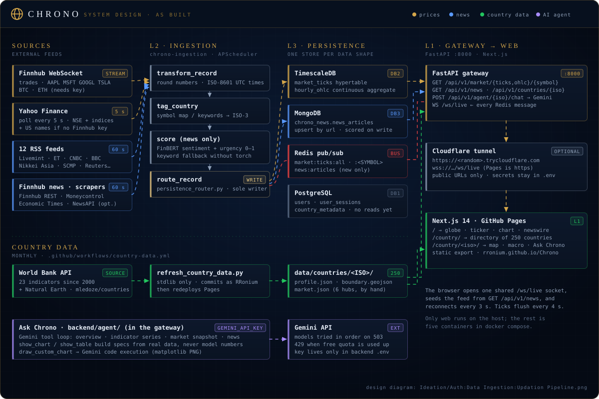

<div align="center">



<br/>


</div>

**Chrono** is a real-time financial command center. It pulls stock, index and crypto prices and
financial headlines from around the world, stores each kind of data in the database built for it,
and streams everything live to a dashboard built around an interactive 3D globe.

> [!NOTE]
> **Status (October 2026): working prototype.** Live prices and live headlines flow end to end.
> Globe colour alerts, the per-country side panel, macro data and login are still in progress, and a
> few panels show labelled **demo data** when they have nothing live. The full, honest inventory
> is in [`AGENTS.md`](AGENTS.md#9-known-bugs-and-fake-data-inventory).


## Architecture



Chrono follows a three-layer design (original diagram:
[`Ideation/Auth:Data Ingestion:Updation Pipeline.png`](Ideation/Auth%3AData%20Ingestion%3AUpdation%20Pipeline.png)).

| Layer | What it does | Built with |
|---|---|---|
| **2 · Ingestion & processing** | A Python worker streams trades from Finnhub, polls Yahoo Finance every 5 s, scrapes Moneycontrol, Economic Times and Reuters every 60 s, cleans each record, tags it with a country code and hands it to one router. A FinBERT classifier scores headline sentiment and urgency. | APScheduler, websocket-client, yfinance, BeautifulSoup, feedparser, transformers |
| **3 · Polyglot persistence** | Each kind of data goes to the store built for it: users and metadata in **PostgreSQL**, price ticks and hourly candles in **TimescaleDB**, scraped articles in **MongoDB**, and live messages through **Redis** pub/sub. | PostgreSQL 15 + TimescaleDB (one container), MongoDB 7, Redis 7 |
| **1 · Presentation** | A FastAPI gateway serves history over REST and fans every Redis message out over one WebSocket. The Next.js dashboard draws the globe, the live ticker, a candlestick chart and the news feed. | FastAPI, Next.js 14, react-three-fiber, lightweight-charts, Tailwind |

**How a price reaches your screen:** Finnhub trade → `route_record` → row in `market_ticks` +
message on `market:ticks:all` → FastAPI `/ws/live` → ticker and chart, with no polling in between.


## Run it

### What you need

- Docker Desktop (or Docker Engine with the Compose plugin)
- Node.js 18+ and npm, for the dashboard
- Optional: a free [Finnhub](https://finnhub.io) API key for streaming US stock and crypto trades.
  Without it, Chrono polls those symbols from Yahoo Finance instead.

### First-time setup

```bash
git clone https://github.com/RRonium/Chrono.git
cd Chrono
cp .env.example .env              # then add FINNHUB_API_KEY=... if you have one
cd apps/web && npm install && cd ../..
```

### Start the project

1. From the repository root, start the five Docker services using the existing images:

   ```bash
   docker compose up -d
   ```

   Use `docker compose up -d --build` only after changing Python code or a Dockerfile. A normal
   restart does not need a rebuild.

2. Confirm that all five containers are running and the three databases are healthy:

   ```bash
   docker compose ps
   ```

   Expected services: `chrono-postgres`, `chrono-mongodb`, `chrono-redis` (all `healthy`),
   `chrono-ingestion` and `chrono-backend` (`running`).

3. Check the backend health endpoint:

   ```bash
   curl http://localhost:8000/
   ```

   Expected response:

   ```json
   {"status":"ok","environment":"development"}
   ```

4. Start the Next.js dashboard in a separate terminal:

   ```bash
   cd apps/web
   npm run dev
   ```

5. Open the dashboard at [http://localhost:3000](http://localhost:3000).

6. *(Optional)* The AI market brief on each country page needs the analytics service, which is not in Docker
   yet. From the repository root, in another terminal:

   ```bash
   pip install -r services/analytics/requirements.txt
   python3 -m uvicorn services.analytics.main:app --reload --port 8001
   ```

   Verify at [http://localhost:8001/docs](http://localhost:8001/docs).

### Check that it works

- The header shows **SYSTEM ONLINE**, meaning the browser is connected to `ws://localhost:8000/ws/live`.
- The **LIVE TICKS** strip fills with symbols within a few seconds.
- The news feed switches from the demo cards to real headlines within about a minute.
- Clicking a country on the globe opens its page: satellite map on the left, economic data on the
  right. Drag the divider to resize the panes. The AI brief there needs step 6.
- API docs: [http://localhost:8000/docs](http://localhost:8000/docs).

### Stop the project

1. Stop the Next.js dev server, and the analytics service if you started it, in their terminals:

   ```text
   Ctrl+C
   ```

2. From the repository root, stop the Docker containers without deleting images or data:

   ```bash
   docker compose stop
   ```

> [!CAUTION]
> Do not use `docker compose down -v`. The `-v` flag deletes the database volumes and with them
> every stored tick and article.

To start again later, repeat **Start the project** from step 1.

### Troubleshooting

If a container is not running, read its logs without rebuilding or deleting anything:

```bash
docker compose logs --tail=50 ingestion backend
docker compose ps
```

Do not also start the backend or the ingestion worker by hand while Docker is running them. That
causes port conflicts on 8000 and duplicate workers that write every tick twice.

<details>
<summary><b>Run the Python services on the host instead (for development)</b></summary>

<br/>

Keep only the databases in Docker, then run each service in its own terminal from the repository
root. In `.env`, set `TIMESCALE_URL` to port **5432** (the example file says 5433, which is wrong
for this setup).

```bash
# Terminal 0: databases only
docker compose up -d postgres mongodb redis
docker compose stop ingestion backend     # if they were already running

# Terminal 1: FastAPI gateway + WebSocket  ->  http://localhost:8000/docs
python3 -m uvicorn services.backend.main:app --reload --port 8000

# Terminal 2: analytics (optional)  ->  http://localhost:8001/docs
python3 -m uvicorn services.analytics.main:app --reload --port 8001

# Terminal 3: ingestion worker
python3 -m services.ingestion.main

# Terminal 4: dashboard  ->  http://localhost:3000
cd apps/web && npm run dev
```

Install each service's dependencies first with `pip install -r services/<name>/requirements.txt`.
Always run Python from the repository root; the services import each other as `services.<name>`.

</details>

### Ports and live channels

| Service | Container | Port | |
|---|---|---|---|
| PostgreSQL + TimescaleDB | `chrono-postgres` | 5432 | db `chrono_db` |
| MongoDB | `chrono-mongodb` | 27017 | db `chrono_news` |
| Redis | `chrono-redis` | 6379 | pub/sub |
| FastAPI gateway | `chrono-backend` | 8000 | REST `/api/v1/*`, WebSocket `/ws/live` |
| Ingestion worker | `chrono-ingestion` | none | |
| Analytics | host, manual | 8001 | optional |
| Dashboard | host, `npm run dev` | 3000 | |

Redis channels: `market:ticks:all`, `market:ticks:<SYMBOL>`, `news:articles`, `news:classified`.


## Country pages

Every country and territory has its own page at `/country/<iso>/` (for example
[`/country/ind/`](https://rronium.github.io/Chrono/country/ind/)), and
[`/country/`](https://rronium.github.io/Chrono/country/) lists them all. A page keeps the dashboard's
header and ticker, puts a satellite map of the country where the globe was, and shows on the right:
key indicators with year-on-year change, growth / inflation / trade trends since 2000, economic
structure, the country's news, the AI brief and its neighbours. The six hub markets also get
exchanges, indices, largest companies with live quotes, and the price chart.

Data lives in one folder per country under [`data/countries/`](data/countries/README.md), refreshed
monthly from the World Bank by a GitHub Action.

## Repository map



Also: `data/countries/<ISO>/` (per-country data the web app and backend both read) and
`scripts/refresh_country_data.py` (rebuilds it).

## Where it is going

| Built | In progress | Planned |
|---|---|---|
| Live ticker from Finnhub + Yahoo | Globe colour alerts from the ML classifier | Live FX and written analysis per country |
| TimescaleDB tick history | Hourly candles for the chart | Login and sessions (tables ready in PostgreSQL) |
| News scraping into MongoDB | Reuters feed | FRED data |
| Country pages with World Bank macro data | | |
| Redis → WebSocket fan-out | Agent brief on real data | Per-country channels for scale |

## Contributing

Read [`AGENTS.md`](AGENTS.md) first. It is the full technical context for people and AI coding
agents alike: every service, store, channel and known bug, plus the rules that keep the stack
healthy. The short version:

- Do not change the Docker healthchecks or `depends_on` in `docker-compose.yml` without asking.
- All database writes go through `services/ingestion/etl/persistence_router.py`.
- Schema changes go in `database/postgres/migrations/`, because init scripts only run on empty volumes.

<div align="center">
<br/>

<sub>Built by <a href="https://github.com/RRonium">@RRonium</a> · prices from Finnhub and Yahoo Finance · headlines from Moneycontrol, Economic Times and Reuters</sub>
</div>
